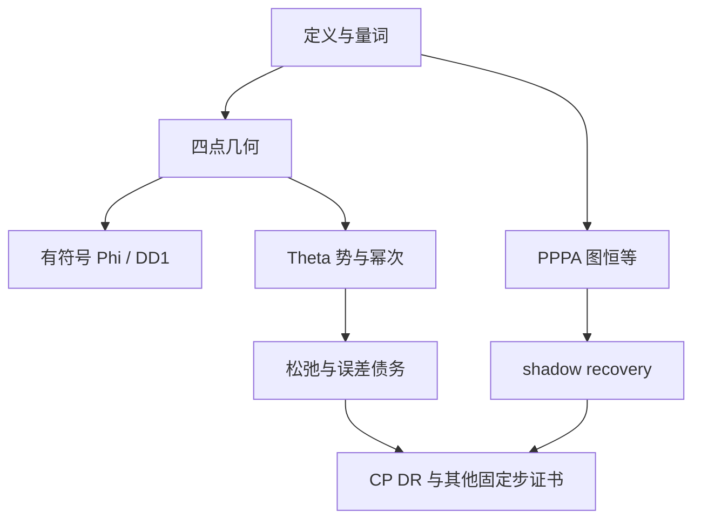

# DD1–DD2 原协议最终数学验收主索引

逐项工作、签收状态及最终答卷在[全量验收清单](DD2_ACCEPTANCE_CHECKLIST.md)。本索引用于定位既有材料。

日期：2026-11-21。研究基线固定为作者指定的 PPA 提交 d6ecad7；当前远端 checkpoint 是本文件提交所显示的最新 main。本文是 §1–§17、八部 28 问、九部 10 项交付物和最终六问的总索引。它不把“每题已经裁决”误写成“每题都是无条件定理”。每一题必须沿下列分节文件进入定义、证明、反例和量词。

## 1. 状态规则和总裁决

- `Proved`：在精确写明的对象、域和量词下有完整证明。
- `Sharp`：除证明外，同一对象类有取等或反例边界。
- `Recovered`：严格恢复了已读文献结果或明确特例。
- `Conditional`：需要文件中列出的附加 coverage、闭图、留域、fiber 或恢复条件。
- `Partial` / `Open`：有可靠中间结果，但主命题或必要性尚未闭合。
- `Refuted` / `Invalid`：原无条件命题有满足量词的反例，或候选公式在声明域上不是精确对象。

阶段提交 `cd028d5` 已建立题号与证据入口。后续[证据复核](FINAL_PROTOCOL_FINAL_REVIEW_2026-11-21.md#dd2-cd-review) 发现部分数学裁决需改正，且完整证明、算子类图和文献矩阵尚有未交齐项目。全协议仍在进行。统一异步和变图仍有 Open 项；一般原模的长度必要性在正 \(b_\psi\)、零或严格吸收非正下界的完整统一类已由 [C454](../topics/dd2/irregular_zero_defect_length.md#dd2-irregular-zero-defect-length) 关闭。任意 signed 数据的全部反向必要性、更强预设目标和受限图类不随之升级。

## 2. Canonical theorem versions

### T1：负缺陷 DD2 / C400

对象是普通 PPA 允许关系、闭目标 S、每条允许边的一个最近输入锚、D(t)>=0 和实际输出真残差模。平面可行域

    0 <= s <= B(t),
    (t-s)_+ <= a <= min(t+s, sqrt(t^2+2D(t)-s^2))

在二维自由两锚闭目标几何中逐尺度尖锐。线性 eta(s)=L s 给出 DD1 两段门 T(L)。C285 的正交近端与在原点聚集的闭零集二周期证明一般完整闭图类的锐性，连续单值及指定目标子类另验。[S03.GATE 的 D1K1–D1K8](../topics/dd2/dd1_recovery.md#dd1-final-calibrated-gate)逐个换参并对每个临界及越界系数给实际精确缺陷的完整坏轨道，同时保严格侧原估计与局部预算。固定一维自由闭目标另由 C445 给不同的三段门。[两份锐性合同及全部义务表](../topics/dd2/dd1_recovery.md#dd1-sharpness-two-scope-contract)把自由几何、完整图、同图尺度序列、全部输出不变窗和真实轨道分别绑定到正文证据。

证据：`research/topics/dd2/core.md#dd2-reverse`，C400，C285，`FINAL_PROTOCOL_S1_S3` 的 §3。

### T1s：有符号缺陷修订版 / C414

对 Phi 可正可负，令 E=t^2-2 Phi。精确步长区间由

    s^2 - t s + Phi(t) <= 0

给出 I_Phi；输出可行集还保留 (t-s)_+、t+s、sqrt(E-s^2) 和 eta(s)。连续 eta 时一维紧集最大值达到；二维三角形和第二锚给自由几何取等。Phi>0 时正部公式只安全不尖锐，t=1、Phi=1/4、eta(s)=s 给出精确值 1/2 而正部值 1/sqrt(2)。

完整陈述和证明：`research/canonical/dd2_general_phi_exact.md`；Claim：`CLAIMS.md#c414`；逐题入口：`research/audit/FINAL_PROTOCOL_S1_S3_2026-11-21.md#§2-一般-phi-psi-的完整刻画`。

### T2：一般势和幂次有限长度 / C401、C399、C416

同一步耗散加 C401 的积分可积性给有限前缀留域和尾长，并恢复[作者原 F1–F3](FINAL_PROTOCOL_S4_S8_2026-11-21.md#dd2-original-f1-f3)。当 \(p=2/q\) 时，令 \(c=\lambda K^{-1/q}\)；一个共同小窗内每条正距离边严格下降的锐常数依次为 \(M<c^2/2\)（\(0<q<1\)）、\(M<T(K/\lambda)\)（\(q=1\)）、\(M<c^2\)（\(q>1\)）。\(pq>2\) 或 \(M=0\) 在小窗给下降。\(q\le1/2\) 的距离收敛允许长度发散甚至点逃逸，\(1/2<q<1\) 的距离、点误差和实际尾长指数有剪切见证。\(q>1\) 的临界失败在一个完整闭图上有任意小初值的二周期。

证据：`research/topics/dd2/core.md#dd2-general-gauge`、`research/canonical/dd2_power_defect_finite_length.md`、`FINAL_PROTOCOL_S4_S8` §5–§6。

[S05.07](FINAL_PROTOCOL_S4_S8_2026-11-21.md#dd2-integrability-weakening-acceptance)进一步区分了等价积分与真删项：F3 非增主函数、原直接积分及共同普通逆窗的和函数逆积分同敛散。[C453](../topics/dd2/original_f_conditions.md#dd2-original-f1-without-f2)在原 F1 不变下以混合支付势删除 F2，完整连续剪切核其实际作用；C454 用原残差壳链、辅助前像和闭完整图给任意原 \(\psi\) 的限定统一类充要门。它们不把固定图、正锚信息和更强目标混入必要性。

[S05.08](FINAL_PROTOCOL_S4_S8_2026-11-21.md#dd2-finite-length-candidate-failures)的五层固定图证据另分清候选失败：C456 的精确原幂模凸径向图全部正可测有效步下界积分仍发散，却有精确尾 tₖ；同数据旋转仍真实无限长。C457 的原锚、原模、最大目标均按尺度精确，真实角度状态可支付而下有界距离势不存在。C453 指定积分差失效、C452 势不能规则化与 C278 所有有限实值距离势不存在均保各自身份；两新身份已逐源终核签收。

[S05.09](FINAL_PROTOCOL_S4_S8_2026-11-21.md#dd2-optimal-tail-acceptance)的 C458–C461 已完成三席实际登记复核：零缺陷连续非减原模由同一个完整旋转准确达到最坏全尾，一般原 ψ 在零前缀消失时保原域得最佳上确界；连续的是派生平方包络。原积分在可积窗的四倍证书、严格逆的可积首项与匹配预算的加法 Lt 界各有独立前件。三个闭完整终止图则排除把点态有限升级为统一预算。实际状态值、距离投影、原数据类和首出域末边分开，未把尾函数公式视为黑箱可计算性证明。

### T3：方向松弛和非精确 / C402、C406、C407

z plus = z - alpha q 的净能量含 gamma=2 beta-alpha；alpha、方向商和缺陷吸收是独立可观测量。相对误差、绝对误差和真实图误差尾分别有不同债务门。逐边门不自动给全锚 Fejer、零聚点或物理 shadow 长度。

证据：`research/topics/dd2/relaxation.md`、`research/topics/dd2/inexact.md`、`research/topics/dd2/adaptive_parameter_audit.md`。

### T4：退化 PPPA、双残差和 shadow / C403、C404、C408

闭值域 P=CC*、完整 lift 和 fiber 条件下有图恒等式和 P-度量真残差传递。projection identification、弱/强 shadow、Lipschitz 和 Hölder recovery、物理有限长度是不同命题；非唯一 fiber 和非闭投影目标给无条件版本反例。

证据：`research/topics/dd2/pppa_recovery.md`、`research/topics/dd2/dual_eb.md`、`FINAL_PROTOCOL_S9_S17` §9–§11。

### T5：算法和分裂 / C405、C412

CP/DR、FBF、外梯度、FRB 及固定网络前向—后向只在文件列出的固定步、闭图、子问题非空、谱门或通信条件下有证书。统一非分离、异步、变图算法仍未闭合。

证据：`research/topics/dd2/splitting.md`、`research/audit/DD2_OTHER_SPLITTING_AUDIT_2026-11-21.md`、`FINAL_PROTOCOL_S9_S17` §12–§14。

## 3. §1–§17 逐题索引

| 原协议 | 逐题审计文件 | 当前总裁决 |
| --- | --- | --- |
| §1.1–§1.10 DD2 身份 | `FINAL_PROTOCOL_S1_S3_2026-11-21.md` §1 | 普通对象和量词 Proved/Conditional；Hilbert、全锚和全窗算子 sharpness Conditional |
| §2.1–§2.10 一般 Phi, psi | 同文件 §2；C414 | Phi<=0 自由几何 Proved/Sharp；任意符号旧 D+ sharp 主张 Invalid；不连续/振荡全局必要性 Partial/Open |
| §3.1–§3.10 DD1 | 同文件 §3；C400/C285 | 两段 T(L) 在自由几何和一般完整闭图类均 Sharp；受限子类另验 |
| §4.1–§4.10 收敛区分 | `FINAL_PROTOCOL_S4_S8_2026-11-21.md` §4 | 距离、点、平方和、长度、残差分层；无条件严格下降到长度 Refuted |
| §5.1–§5.10 F1–F3 与势 | 同文件 §5；C453–C454、C456–C461、C463–C464 | S05.01–S05.10 已签收；AM1–AM6、C463/SC与C464/EK的完整证明和边界均经三席实际终稿复核。同数据最优、原生状态、凸几何和KL范围已分清；S05.F1的原式来源、FA1–FA9及完整边界已获三席实际复核，验收限可追溯存录版及其数学内容；S05.F2的逆模等价、精确窗口、点态渐近反例与完整边界已获三席实际复核；S05.F3的精确主函数合同、最小上界两倍比较和函数边界已获三席实际终稿复核；S05.TELESCOPE的原P/G支付、首出步、两项明确删减及完整边界已获三席实际终稿复核；§5全部签收，幂次阶段另见§6。 |
| §6.1–§6.10 幂次 | 同文件 §6；C285/C399/C416 | S06.01两支统一机制、预设目标护栏和真实好临界线性链已获三席实际终稿复核；S06.02准确统一半阶门、完整反向、负预算目标和一维边界已获三席实际终稿复核；下一项S06.03，其余专项仍按清单逐项验收。既有一般闭目标完整图临界证据保原范围，受限图类最优率另核。 |
| §7.1–§7.10 实际算子类 | 同文件 §7 | 有 Holder、非单调、非凸、非孤立和多值例；全类严格包含关系 Partial |
| §8.1–§8.8 猜想攻击 | 同文件 §8 | 八个无条件猜想均有 Refuted 或 Conditional 边界 |
| §9.1–§9.12 约化前向 | `FINAL_PROTOCOL_S9_S17_2026-11-21.md` §9 | 闭值域和完整 lift 下 Conditional/Proved；非闭投影和 kernel 逆向 Refuted |
| §10.1–§10.12 shadow recovery | 同文件 §10 | projection、聚点、weak/strong、Lipschitz/Hölder、一点/二点逐项分离 |
| §11.1–§11.10 双残差 | 同文件 §11 | 图代数恒等 Proved；联合补偿和逆向普通范数 Conditional/Refuted 无条件版本 |
| §12.1–§12.12 算法分析 | 同文件 §12 | 固定步和势条件下 Conditional/Sharp 子类；统一复杂度和任意算法 Open |
| §13.1–§13.12 自适应/非精确 | 同文件 §13 | 逐边参数和误差债务 Conditional；统一最宽区域 Open |
| §14.1–§14.12 CP/DR/分裂 | 同文件 §14 | 固定步可验证子类 Conditional；泛化算法 Open |
| §15.1–§15.10 文献 | 同文件 §15 | 已读版本 Recovered/Conditional；全球优先性 Open |
| §16.A–§16.H 新颖性 | 同文件 §16 | A 的旧公式在已读范围 Recovered，但 C414 的全球先行性为 Partial/Open；C/H 在声明子类 Sharp，其余 Partial/Conditional |
| §17.1–§17.15 独立审查 | 同文件 §17 | 逐项完成检查；一般振荡 gauge、弯曲低 L、弱 kernel 和全局新颖性仍有 fatal objection |

`FINAL_PROTOCOL_S9_S17_2026-11-21.md` 还逐项回答第八部分 28 个深层问题、第九部分 10 项交付物和最终六问；这些不是另一个摘要，而是与 §9–§17 同一证据链的索引。

## 4. 依赖图

核心依赖是：定义和允许图量词先于平面引理；平面引理先于 DD1 和一般包络；同一步严格耗散另加势积分条件；PPPA recovery 不由距离下降自动提供；分裂应用必须同时验证约化和原空间恢复。

## 5. 反例和锐性图谱

- 正 Phi 的 D+ 非尖锐：C414 反例。
- 严格下降但无限长度：`core.md#dd2-trajectory` 的 L=1 调和旋转。
- q=1/2、q<1/2 完整图无限长度：`FINAL_PROTOCOL_S4_S8` §6.3。
- \(q>1\) 的临界及次临界完整闭图二周期：[C416](../canonical/dd2_power_defect_finite_length.md#dd2-superlinear-power)。\(q\ge1\) 的横向固定闭图链见 C415。
- 低 L 固定闭图与闭凸锚障碍：C411、C413、`lowL_dynamic_sharpness.md`。
- 远 kernel、非唯一 fiber、非闭投影目标：`pppa_recovery.md` 逆向障碍。
- 选定图值冒充完整真残差：C408 的 G(y)={y,y³}。
- 松弛边界和非精确误差：C406、C407、`inexact.md`。
- FRB 欧氏下降失败及 CP/DR 慢速例：`DD2_OTHER_SPLITTING_AUDIT_2026-11-21.md`、`splitting.md`。

## 6. 文献和算子类边界

P0 审计逐式核对 Lauster–Luke 2021、Alcantara v1、Li–Mordukhovich 2012 及 Holder PPA 先例。当前能负责任地写的是 Recovered/Conditional：DD2 的最近锚、允许子关系、函数缺陷、共同 s 和 physical recovery 是明确的扩展接口，但不能用有限检索声称全球首创，也不能把全锚或自映射文献的假设悄悄删除。

算子类图应按共同对象和量词比较：普通 PPA ⊂（在附加覆盖条件下）退化 PPPA 的约化子类；几何 DD2 包络覆盖更多自由闭目标构形，但固定凸/单值全图的严格包含仍未证明；CP/DR、FBF、EG、FRB 是各自能量证书的交叉子类，不组成无条件统一包含链。

## 7. 强制交付物定位及状态

以下定位包含正式资产和已有片段。第 2、5、6、7 项仍有未交齐内容，逐项状态见 [§9–§17 的第九部分](FINAL_PROTOCOL_S9_S17_2026-11-21.md#dd2-protocol-deliverables)。其中旧文献和算子类要求的是同一对象和对应量词下逐项证明，文件导航本身不提供这种裁决。

1. Canonical theorem statements：本文件 T1–T5、`core.md`、`relaxation.md`、`pppa_recovery.md`、C414。
2. 完整证明：上述规范正文及 `FINAL_PROTOCOL_S1_S3`、`FINAL_PROTOCOL_S4_S8`、`FINAL_PROTOCOL_S9_S17`；未闭版本明确标 Partial/Open。
3. Dependency graph：本文件第 4 节、`research/graph.json`、`research/HYPERGRAPH.md`。
4. Counterexample and sharpness atlas：本文件第 5 节、`FAILED_ROUTES.md`、C399/C400/C411/C413/C414。
5. Literature matrix：`research/LITERATURE.md`、`DD2_P0_PRIOR_ART_2026-11-21.md`、`FINAL_PROTOCOL_S9_S17` §15。
6. Operator-class inclusion map：本文件第 6 节、README Claim Map、C404/C405/C408。
7. DD functional compensation map：C414、`core.md`、`dual_eb.md`、`relaxation.md`、C399。
8. Algorithm transfer dossier：`pppa_recovery.md`、`splitting.md`、`inexact.md`、C404–C406、C412。
9. Reproducible experiments：`research/code/dd2/verify_outline.py`、`research/validate_assets.py`、`research/build_graph.py` 及离线可视化脚本；它们只能验证结构，不能替代数学证明。
10. Research frontier report：本文件第 8 节、`RESEARCH_STATE.md`、`FAILED_ROUTES.md` 和每个逐节审计文件的 Open/Partial 列表。

## 8. 仍未闭合的精确义务

1. 任意振荡或不连续 gauge 的统一非减包络的必要性与最佳性。
2. 一般弯曲闭凸目标上低 L 严格步长支的完整固定图分类。
3. 弱 kernel 控制下的 full-fiber coverage 和原空间逆向误差界。
4. 非唯一 fiber 下所有 shadow 选择的强收敛和物理有限长度。
5. 统一松弛、异步、变图、非分离多算子和带噪物理恢复。
6. CP/DR 中同时满足非零 U、非单调、非线性慢速和完整 recovery 的更大实例族。
7. 与所有旧 RLEB、Luke–Tam、Alcantara 版本的全球严格优先性和不可比较性。

这些是 Open/Partial，不是“登记即完成”。下一步最有信息量的是逐一攻击上述义务并保留严格反例或新定理，而不是继续增加形式相似的摘要。

## 9. 可复现检查和 checkpoint

阶段提交 `cd028d5` 报告的结构检查：

- `python3 research/validate_assets.py`：通过，240 manifest hashes、251 audited source files、178 ZIP members、4827 source units、4671 atomic records、955 nodes、720 edges、497 Markdown files。
- `python3 research/code/dd2/verify_outline.py`：通过，6 ordered sections、7 claim records、15 local links、7 exact algebra checks。
- `python3 research/build_graph.py`：通过，更新 graph.json/HYPERGRAPH.md；离线 cosmos/xianxia 构建也通过。

最终主索引及相关审计必须和数学文件一起提交并推送；若本地环境重置，可从 README -> 本文件 -> 三个逐节审计 -> Claim/正文/失败路线恢复。
