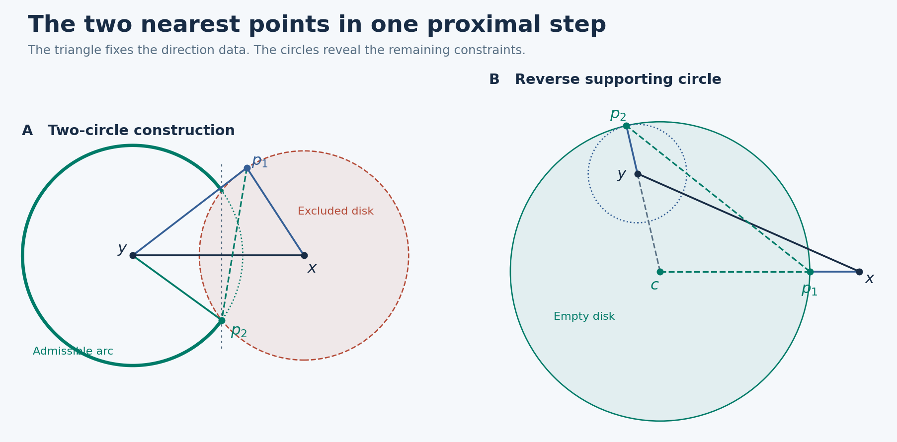

# 从平面圆与三角形到原 PPA 的两锚几何

固定非空闭零目标 \(S\subseteq F^{-1}(0)\) 和原步 \(x=y+\lambda v,\ v\in F(y)\)，\(\lambda>0\)。按原图标注 \(p_1\in P_S(x)\)、\(p_2\in P_S(y)\)。写 \(a=|xp_1|\)、\(b=|yp_1|\)、\(t=|yp_2|\)、\(s=|xy|\)、\(D=|p_1p_2|\)。所有范数均为欧氏范数。完整残差 \(r_F(y)=\inf_{w\in F(y)}\|w\|\) 只给 \(t\le\psi(r_F(y))\le\psi(s/\lambda)\) 或 \(s\ge\lambda\chi(t)\)，依所用误差界方向而定。原模函数不需要线性化。

## C383 · 两圆截出的弧精确控制锚距

**平面作图。** 固定三角形 \(xyp_1\) 和输出半径 \(t\)，假定 \(s,b,t>0\)、\(t\le b\)。在以 \(y\) 为圆心、\(t\) 为半径的圆上走动 \(p_2\)。输入最近点条件要求 \(|xp_2|\ge a\)，因此必须留在以 \(x\) 为圆心、\(a\) 为半径的开圆之外。可行性恰为 \(a\le s+t\)。若 \(s\ge a+t\) 或 \(t\ge a+s\)，全圆可用。其余可行情形由两圆交点截出允许弧，允许弧包括与 \(yx\) 方向相反的点。

令 \(\theta=\angle xyp_1\)。令 \(\phi\) 为允许弧上射线与 \(yx\) 的最小夹角，即
\[
\cos\phi=\min\left\{1,\frac{s^2+t^2-a^2}{2st}\right\}.
\]
对着 \(p_1\) 的径向点若落在允许弧上，就是离 \(p_1\) 最近的点。若落在弧外，沿圆走到同侧最近的弧端点。离 \(p_1\) 最远的点按同一方法从它的反向径向点找。两侧极值通过欧几里得《几何原本》I.24 的两边夹角比较确定。于是 \(\angle p_1yp_2\) 的最小、最大值分别是
\[
\delta_{\min}=(\phi-\theta)_+,\qquad
\delta_{\max}=\pi-(\phi+\theta-\pi)_+.
\]
锚距的精确区间由余弦定理给出
\[
\sqrt{b^2+t^2-2bt\cos\delta_{\min}}
\ \le D\le\
\sqrt{b^2+t^2-2bt\cos\delta_{\max}} .
\tag{1}
\]
整个区间可在平面实现。理由是允许弧连通，弦长连续，两端取到。任意这样取得的构形都可用两点闭集 \(S=\{p_1,p_2\}\) 实现最近点关系。若 \(t=0\)，则 \(p_2=y\)、\(D=b\)。若 \(b=0\)，则跟着有 \(t=D=0\)。若 \(s=0\)，则 \(a=b=t\)，在维数至少二时任意 \(D\in[0,2t]\) 均可由两个最近点实现。

**高维还原。** 令 \(e=(x-y)/s\)。两圆的交界条件变成
\[
\langle p_2-y,e\rangle \le (s^2+t^2-a^2)/(2s).
\tag{2}
\]
固定 \(p_2-y\) 在 \(e\) 上的分量后，垂直分量长度固定。与 \(p_1-y\) 的垂直分量取同向或反向恰好达到 Cauchy–Schwarz 的两个端点。两个取等构形都在 \(x,y,p_1\) 的平面内，若三点共线就取任一包含该直线的平面。因此 (1) 对任意至少二维的实内积空间成立，并且逐步最坏值无需超过二维。若额外要求保留实际六条边，则一般需要三维。例如 \(y=0,x=e_1,p_1=-e_2,p_2=e_3\) 满足两条最近性，六边长度决定秩为 3 的 Gram 矩阵。逐步角度和锚距的可行区间也不决定同一零集上的跨步轨道。

**另一个平面还原。** 即使要求 \(S\) 凸，只保存 \(s,a,b,t,D\) 这五条边仍可还原到平面。对凸集，投影的支撑不等式给 \(|xp_2|^2-a^2\ge D^2\)、\(b^2-t^2\ge D^2\)。反过来这两不等式足以让 \(p_1,p_2\) 成为线段 \([p_1,p_2]\) 上的最近点。绕 \(yp_1\) 轴折叠 \(p_2\)，使它在该轴的垂直分量与 \(x\) 的垂直分量反向。该折叠保留五条边，且只能增加 \(|xp_2|\)，因此保留两个支撑不等式。在高维，这一步仍是同一个 Cauchy–Schwarz 极值。若 \(S\) 是固定仿射集，则两不等式要求等号，折叠增加 \(|xp_2|\) 后未必还能保持。

**直接给图上的锚边加上界。** 如果再标明 \(D\le L_{\rm a}\)，三角不等式把 \(b\) 限制在 \([t,t+L_{\rm a}]\)。方向角按 C381 取 \(\cos\theta\le\alpha\)，\(0\le\alpha\le1\)。由欧几里得 II.12–13 的勾股展开，
\[
 a^2\ge (1-\alpha^2)s^2
       +(t-\alpha s)_+^2+(\alpha s-t-L_{\rm a})_+^2.
\tag{2a}
\]
取等的平面构形是：先把 \(b\) 取为 \(\alpha s\) 在区间 \([t,t+L_{\rm a}]\) 的最近点，再把 \(p_1,p_2\) 都放到从 \(y\) 出发、与 \(yx\) 夹角余弦为 \(\alpha\) 的一条射线上，距离分别为 \(b,t\)。若 \(b>t\)，则 \(b\le\alpha s\)，所以 \(x\) 在该射线上的垂足越过 \(p_1\) 或恰到 \(p_1\)。取线段 \(S=[p_2,p_1]\) 即得到两个正确投影。这个例子使 (2a) 逐步取等。

若 \(L_{\rm a}=\mu s\) 且 \(t\le\gamma s\)，则 (2a) 给
\[
 a-t\ \ge\
 \left[\sqrt{1-\alpha^2+(\gamma-\alpha)_+^2+
                   (\alpha-\gamma-\mu)_+^2}-\gamma\right]s .
\tag{2b}
\]
证明只需注意归一化的根式可写成 \(\sqrt{1-\alpha^2+d(\alpha,[t/s,t/s+\mu])^2}\)，它关于 \(t/s\) 是 1-Lipschitz。若系数为正，原覆盖和留域下可直接支付原步长度。例如 \((\alpha,\gamma,\mu)=(0.9,0.5,0.1)\) 给正系数 \(\sqrt{0.28}-0.5\)，不限制锚距时的 C381 系数为 \(\sqrt{0.19}-0.5<0\)。原算子能否验证这一锚边上界是一项独立义务。

**原步应用。** 若只知 \(t\le\psi(s/\lambda)\)，对 \(0\le t\le\min\{b,\psi(s/\lambda)\}\) 且 \(a\le s+t\) 取 (1) 的上确界，即给原图这类数据允许的锚距。固定真实 \(t>0\) 的平面极值还能由完整原关系实现。先以全部 \(P_S\) 图为近端关系，再加入一条 \(x\to y\)，取 \(F(u)=\{(z-u)/\lambda:u\in J(z)\}\)。由于 \(y\notin S\)，该输出纤维只有这条新边，故完整 \(r_F(y)=s/\lambda\)。这是一步实现，轨道性质需另证。

**Thales 的原图边界。** 在二维取 \(x=(1,0),y=(0,0)\)、\(1/\sqrt2<\alpha<1\)、\(\beta=\sqrt{1-\alpha^2}\)，并取 \(p_1=(\alpha^2,\alpha\beta),p_2=(\beta^2,\alpha\beta)\)。四点同在直径 \(xy\) 的圆上，两个直角就在锚点。\(a=t=\beta,\ b=\alpha\)，而 \(p_1,p_2\) 分别是唯一最近点。两点的连线段 \(S=[p_2,p_1]\) 也给出相同投影。取 \(K=\lambda\beta\)，先令 \(F_0(z)=(z-P_Sz)/K\)，再分别在 \(y,x\) 的完整纤维加入 \((x-y)/\lambda,(y-x)/\lambda\)。径向基线原根为 \(P_Sx+\frac{K}{K+\lambda}(x-P_Sx)\)，沿同一投影射线移动，方向功非负。两个新值与基线值同范数，故 \(r_F=d(\cdot,S)/K\) 全域精确成立。新图闭、每个位置纤维非空，每个输入有基线原根。两个方向的周期边都达到 C381 第二段等号。这是二维、紧凸零集、完整覆盖的边界例。C381 的高维线性仿射零集见证另有自己的范围。

## C384 · 一个相切空圆给原 RL 的有限尺度加强

**平面几何条件。** 设 \(a>0,0\le t<\rho\)，\(\rho>0\)。从 \(p_1\) 沿 \(p_1-x\) 的方向走距离 \(\rho\)，到圆心 \(c\)。要求开圆 \(B(c,\rho)\) 不碰 \(S\)，即 \(d(c,S)=\rho\)。这是一个在 \(p_1\) 接触零集的反向空圆。若 \(p_2\) 在以 \(y\) 为圆心、\(t\) 为半径的圆上且在空圆外，必有 \(|yc|\ge\rho-t\)。若 \(s>a+t\)，两锚的相对位置因此必须贡献正的平方距离差。

**内积证明。** 令 \(n=(x-p_1)/a\)、\(B=b^2-t^2\ge0\)。平方展开 \(\|y-p_1+\rho n\|\ge\rho-t\) 给
\[
\langle n,y-p_1\rangle\ge-t-\frac{B}{2\rho}.
\]
再展开 \(s^2=\|a n-(y-p_1)\|^2\)，得到
\[
 B\ge\frac{(s^2-(a+t)^2)_+}{1+a/\rho}.
\tag{3}
\]
如果同一个输入最近点满足原反射模 \(\|2y-x-p_1\|\le\omega(a)\)，中点和勾股等价的平行四边形恒等式给 \(b^2+s^2\le(a^2+\omega(a)^2)/2\)。将 (3) 代入得
\[
\boxed{\quad
 t^2+s^2+\frac{(s^2-(a+t)^2)_+}{1+a/\rho}
 \le \frac{a^2+\omega(a)^2}{2}.
 \quad}
\tag{4}
\]
这里的正部项直接来自空圆，未调用光滑性或线性模。给定完整非线性真残差下界 \(r_F(y)\ge\chi(t)\) 时，(4) 中可把 \(s\) 换为 \(\lambda\chi(t)\) 得必要条件，因为左边非减于 \(s\)。原误差模 \(\psi\) 也可直接和 (4) 的 \(s\) 变量合取，无需求逆。原根覆盖仍需独立条件。

**完整几何最小值。** 给定 \(a>0,t\ge0,s\ge|a-t|\)，保留同一个反向空球。在至少二维的空间，允许目标集改变时，\(B\) 的最小值精确为
\[
 B_{\min}=\max\left\{0,\ (s-a)_+^2-t^2,\ \frac{s^2-(a+t)^2}{1+a/\rho}\right\}.
\tag{4a}
\]
第二项用 \(b\ge s-a\)。当 \(t\ge\rho\) 时，只需第一、二项，因为第三项在 \(s>a+t\) 时不大于第二项。取等有三个平面构形。若 \(s\le a+t\)，两锚合一，由三角形三边实现。若 \(a+t<s\le a+2\rho-t\)，取半径 \(\rho\) 的圆周，\(x\) 在外、\(y\) 在内，半径分别为 \(\rho+a,\rho-t\)，调夹角即可。若 \(s>a+t\) 且已越过这个圆的远端容量，则沿直线反向放 \(y\)，再向远离 \(p_1\) 的方向放 \(p_2\)，令锚距 \(s-a+t\ge2\rho\)。这时 \(S=\{p_1,p_2\}\) 且第二项取等。对给定 \(a,t,s\)，反射平方的最小值是 \(2[t^2+s^2+B_{\min}]-a^2\)。所以 (4a) 给非线性原反射约束精确的一步几何判据。

**有限尺度与等号。** 若 \(s\ge\eta t,\ \eta=\lambda/K>2\)，且 \(t\ge a\)，则 (4) 强制
\[
 \left(\frac{\omega(a)}a\right)^2
 \ge 1+2\eta^2+\frac{2(\eta^2-4)}{1+a/\rho}.
\tag{5}
\]
因此右侧是排除不下降原边的门。与 [C285](../../canonical/rleb_sharp_linear_frontier.md#rsl-threshold) 的自由闭集高参数门相比，\(a/\rho<2/\eta\) 时有严格改善。随 \(a/\rho\to0\)，恢复 [C288](../../canonical/rleb_nearest_anchor_geometry.md#rng-manifold) 的高参数极限 \(\sqrt{4\eta^2-7}\)。若 \(S\) 是半径 \(\rho\) 的圆周，\(x\) 位于外侧、\(y\) 位于内侧，最近点对应两条半径，则 \(|yc|=\rho-t\) 使第一步取等。给定 \(a=t<\rho\)、\(\eta a\le2\rho\)，改变两条半径的夹角使 \(s=\eta a\)，可达到 (5) 的等号。这个例子认证单边锐性。若要取整条临界不收敛轨道，反向边要另外满足同模。

用 (4a) 还可得到对每个 \(a>0,\eta>0\) 的精确单边非下降阈值。最小的 \((\omega(a)/a)^2\) 为
\[
1+2\eta^2+2\max\left\{0,\ (\eta-1)_+^2-1,\
  \frac{\eta^2-4}{1+a/\rho}\right\}.
\tag{5a}
\]
理由是 \(s\ge\eta t,\ t\ge a\) 下，\(t^2+s^2+B_{\min}\) 对 \(s\) 非减。代入 \(s=\eta t\) 后，在 \(t\ge a\) 上每个取正部的附加项均非减，故最小在 \(t=a\)。各项非减可直接对正值所在区间的二次式求导。三种 (4a) 的平面构形实现等号。若 \(\eta>2\) 且 \(a/\rho\ge2/\eta\)，三角不等式项主导，回到旧的 \(2\eta-1\) 门。

**原轨道推论。** 设覆盖工作域 \(U_R=\{x\in U:d(x,S)\le R\}\)，\(U\) 开。每条允许边都有满足上述反射模和反向空球条件的同一个 \(p_1\)。设 \(R>0,\rho>0,\eta>2\)、\(\omega(a)\le La\)、\(d(y,S)\le K r_F(y)\)，误差界覆盖全部允许输出。若
\[
 L^2<1+2\eta^2+2(\eta^2-4)/(1+R/\rho),
\]
则有统一 \(\kappa<1\) 使 \(d(y,S)\le\kappa a\)，且 \(s\le(1+L)a/2\)。证明只用适用于所有 \(t\) 的 (4a)。把 (4) 的左边第三项视为 \(B_{\min}\) 的一个下界，再除以 \(a^2\)，用 \(a/\rho\le R/\rho\)。在 \(t/a\ge1\) 时所需的下界单调递增，在 \(t/a=1\) 时已严格越门。连续性给同样排除 \(t/a\in[\kappa,1]\) 的某个统一 \(\kappa<1\)。\(a=0\) 时反射条件使 \(y=x\)。从满足 \((1+L)d(x^0,S)/(2(1-\kappa))<d(x^0,U^c)\) 的 \(x^0\in U_R\) 出发，以有限前缀几何长度预算保证留域，再得原轨道有限长、在 \(S\) 点收敛。

反向空球与正 reach 不是同一条件。实心圆盘有唯一全域投影，但在外点的最近锚向圆盘内侧走，不能放置这种反向空圆。空球条件和上述结论原样提升为高维空球与内积式。

## C385 · 两个正向空圆对锚距的锐控制

另设 \(0<a,t<\rho\)，沿 \(p_1x\) 和 \(p_2y\) 的方向分别从锚点走距离 \(\rho\)。要求以这两个新点为圆心、半径为 \(\rho\) 的开球均不交 \(S\)。这些是各自沿最近向量正向延伸的空球。则
\[
s^2\ge
\begin{cases}
(a-t)^2+(1-a/\rho)(1-t/\rho)D^2,&D\le 2\rho,\\
(D-a-t)^2,&D\ge 2\rho.
\end{cases}
\tag{6}
\]
两段边界都能在平面达到。短弦取半径 \(\rho\) 的圆周，两点由圆上锚点向内偏移 \(a,t\)。长弦取零集为相距 \(D\) 的两点，两点沿锚弦相向偏移。

证明长弦用三角不等式。短弦设 \(D>0,\ e=(p_1-p_2)/D,\ u=(x-p_1)/a,\ w=(y-p_2)/t\)。由各自圆幂非负，\(\langle u,e\rangle\ge-D/(2\rho)\)、\(\langle w,e\rangle\le D/(2\rho)\)。记 \(U=\langle u,e\rangle+D/(2\rho)\ge0\)、\(V=D/(2\rho)-\langle w,e\rangle\ge0\)。在
\[
s^2-(a-t)^2=D^2+2D\langle au-tw,e\rangle+at\|u-w\|^2
\]
中仅保留最后一项沿 \(e\) 的平方分量，代入后比 (6) 下界多
\[
2D[a(1-t/\rho)U+t(1-a/\rho)V]+at(U+V)^2\ge0.
\]
短弦 \(D=0\) 由三角不等式。函数 (6) 两段在 \(D=2\rho\) 相接且对 \(D\) 严格递增。于是 \(s\le2\rho-a-t\) 时可直接反解
\[
 D\le \sqrt{\frac{s^2-(a-t)^2}{(1-a/\rho)(1-t/\rho)}} .
\tag{7}
\]
较大 \(s\) 时用 \(D\le s+a+t\)。这给出从实际一步三条边到锚移动的定量关系。要用它独立保证点收敛，仍须让锚位移可和，或另证序列收敛。

## C386 · 两条平行线改变 C381 的跷跷板边界

若 \(S\) 是余维一仿射超平面，则 C381 的同一锚角条件与线性完整真误差界 \(d(y,S)\le K r_F(y)\) 给统一严格门
\[
 \frac{\lambda}{K}>\frac{\alpha}{\sqrt{1-\alpha^2}},\qquad 0\le\alpha<1.
\tag{8}
\]
这里在原空间的最坏情形是输出与输入均在同一条平行于零集的超平面上。当 \(0<\alpha<1\) 时，这个门比 C381 的自由闭集门低。它加强几何内容而保留原近端方程。

**证明。** 按实际正步长归一成 \(s=1\)，选定正法向使输出高度 \(u=t/s\ge0\)，输入有符号高度为 \(u-\delta\)。垂直于法向的位移平方为 \(1-\delta^2\)。若距离不下降，则 \(0\le\delta\le\min(1,2u)\)。角度条件要求
\[
 1-\delta^2+u\delta\le\alpha\sqrt{1-\delta^2+u^2}.
\]
当 \(u>0\) 时，左边与根式的比至少为 \(1/\sqrt{1+u^2}\)。平方交叉相减后，差为 \(\delta^2u^4+(1+u^2)\delta(2u-\delta)(1-\delta^2)\ge0\)。当 \(u=0\) 且距离不降，\(\delta=0\)，比为 1。因为 \(u\le K/\lambda\)，(8) 排除距离不降。紧致的归一化矩形 \([0,K/\lambda]\times[-1,1]\) 中，实际锚角约束由上式给出一个闭集。连续差 \(|u-\delta|-u\) 在非空可行集上有统一正最小值，因此可用距离差支付 \(\sum s_k\)。原根覆盖和局部留域沿 C381 的有限前缀证明。

对每个 \(0<\alpha<1\)，平面单值图 \(F(z,b)=(cb,0)\) 取 \(\lambda c=\alpha/\sqrt{1-\alpha^2}\)，全域原根存在，\(r_F(z,b)=c|b|\)、\(K=1/c\)。在每个非零高度，原步水平移动、到零集的距离不变，锚角恰好取等。故 (8) 是该类的锐门。\(\alpha=1\) 时同一个剪切族排除任何有限的 \(\lambda/K\) 统一门。余维二及以上可出现法向旋转，不能沿用此证明中的单一有符号高度。

## 搜索与试证记录

| 经典入口 | 在原图中实际完成的动作 |
| --- | --- |
| 欧几里得 I.24–25 两边夹角判据，II.12–13 余弦定理的几何前身 | 给出 C383 的同、反向弧端点及距离极值，也给出 C381 三角形侧边的内积表达。 |
| 欧几里得 III.31，Thales 直径圆 | 用两个直角构造 C381 上段的二维完整原二周期。 |
| 欧几里得 III.35–36，圆幂 | 距离平方减半径平方把两个最近距离圆和空圆写成半空间。两个正向圆幂联立得到 C385。 |
| 中点定理与平行四边形，欧几里得 I.47、II.9–10 | 把原反射模的圆变成 \(b^2+s^2\) 上界，和 C384 的空圆下界同用。 |
| Stewart、Apollonius 中线恒等式 | 在 \(xp_1\) 中点的代入恢复 C285 的能量界。没有额外弧信息时不增加原边控制。 |
| Apollonius 比例圆 | \(t=|yp_2|\le\gamma|yx|\) 在固定 \(x,p_2\) 的图上确实给比例圆或半平面。就本题的固定三角形、移动 \(p_2\) 而言，它变成半径上界，仍须与输入最近性合取。 |
| 托勒密与球反演 | 四点乘积不等式可以通过反演提升到高维。直接代入时仍含未控制的边 \(|xp_2|\)，只有把该边数据留下才能作附加检验。四点默认共圆会丢掉一般构形。 |
| 支撑线、凸投影及 Federer 的 reach | 支撑线提供对锚弦的内积符号。正向、反向空球分别进入不同命题。reach 与正向投影延伸的背景可参考 Federer §4.8，正文直接假设所画空球并自足证明。 |
| 等幂轴与截弧 | 在固定 \(t\) 的圆或球面，用 (2) 线性截去与输入最近性冲突的部分，把最坏锚距精确还原为二维问题。 |

一手或作者原稿入口：[Euclid I.24](https://mathcs.clarku.edu/~djoyce/java/elements/bookI/propI24.html)、[II.12–13](https://mathcs.clarku.edu/~djoyce/java/elements/bookII/bookII.html)、[III.31](https://www.euclids-elements.org/elements/books/bookIII/propositions/propIII31/)、[III.35](https://mathcs.clarku.edu/~djoyce/java/elements/bookIII/propIII35.html)、[III.36](https://mathcs.clarku.edu/~djoyce/java/elements/bookIII/propIII36.html)。反演参看 [Buckley–Falk–Wraith，Ptolemaic spaces and CAT(0)，§1](https://archive.maths.nuim.ie/staff/sbuckley/Papers/ptolemy.pdf)。reach 参看 [Federer, Curvature Measures, Trans. AMS 93 (1959), §4.8](https://doi.org/10.1090/S0002-9947-1959-0110078-1)。Stewart 和 Apollonius 见 [Kin Y. Li 的课程讲义 §9](https://www.math.hkust.edu.hk/~makyli/190_2010Sp/190_LectNt-rev.pdf)，相切圆构图参看 [Yufei Zhao 的竞赛讲义 §2](https://web.mit.edu/yufeiz/www/imo2008/zhao-circles.pdf)。正文的 PPA 不等式由各段直接推导，无需导入文献中的算法定理。

本轮把图中的距离、圆和夹角变成四条可检验命题。进一步用原算子数据自动生成空球条件，或从只知步长上界和完整误差界控制非孤立零集的累计锚移动，仍是不同的证明义务。
