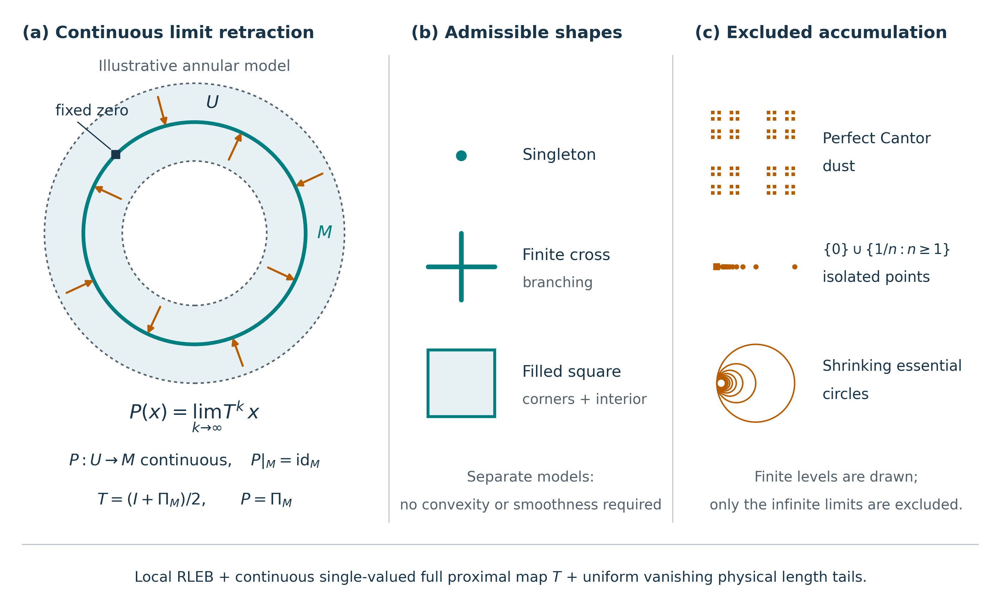

# RLEB 认证零簇的连续邻域回缩：论文示意图



英文图：[PDF](图件/rleb-neighborhood-retraction.pdf) · [SVG](图件/rleb-neighborhood-retraction.svg) · [PNG](图件/rleb-neighborhood-retraction.png)。中文图：[PDF](图件/rleb-neighborhood-retraction-cn.pdf) · [SVG](图件/rleb-neighborhood-retraction-cn.svg) · [PNG](图件/rleb-neighborhood-retraction-cn.png)。图面为 180 × 110 mm，面向一般数学论文；尚未指定期刊，不声称符合某一期刊的投稿规格。

## English standalone caption

**Continuous neighborhood retraction onto a certified zero cluster.** Under local RLEB, complete proximal coverage, a continuous single-valued physical proximal map, and uniformly vanishing physical length tails on an invariant open neighborhood, the orbit limit defines a continuous retraction \(P:U\to M\) onto the certified cluster \(M\), with \(P|_M=\mathrm{id}_M\). **(a)** An illustrative annular model has \(M=S^1\), \(U=\{x:0.65<\|x\|<1.35\}\), \(T=(I+\Pi_M)/2\), and \(P=\Pi_M\). The pale annulus is the input neighborhood; dashed curves mark its excluded boundary. Orange arrows point from inner and outer inputs to their limits, and the square marks a zero that remains fixed. **(b)** A singleton, a finite branched cross, and a filled square are separately realized examples; no union of these shapes is asserted. Convexity and smoothness are not required. **(c)** Perfect Cantor dust, isolated points accumulating at an included zero, and shrinking essential circles (the Hawaiian earring) violate the local-contractibility consequence of the full package. Only finite levels are drawn; the displayed finite approximations are not themselves excluded. The conclusion concerns the certified cluster, which need not be the complete zero set. The arrows do not assert one-step arrival or a general deformation retraction. Anchor-only multivalued RLEB does not supply the continuity gate.

## 中文独立图注

**认证零簇上的连续邻域回缩。** 合取局部 RLEB、完整近端覆盖、连续单值的物理近端映射，以及前向不变开邻域上一致趋零的物理长度尾界，轨道极限给出连续回缩 \(P:U\to M\)，且 \(P|_M=\mathrm{id}_M\)。**(a)** 环形示例取 \(M=S^1\)、\(U=\{x:0.65<\|x\|<1.35\}\)、\(T=(I+\Pi_M)/2\)，因此 \(P=\Pi_M\)。浅色环带是输入邻域，虚线是未包含的边界；橙箭头从环内侧和外侧的输入指向极限，方形标记的零点保持不动。**(b)** 单点、有限分叉十字和实心方形分别由不同完整算子模型实现，不表示三者的并集是本图指定的零集；零簇不必凸或光滑。**(c)** 完美 Cantor 尘集、含积聚零点的孤立点序列和不断缩小的本质环圈（夏威夷耳环）违反整套前提推出的局部可缩性。这里只画有限层级；这些有限近似本身并不被排除。一般结论只涉及认证零簇，不自动涉及全部 \(\operatorname{zer}F\)。箭头既不表示一步到达，也不宣称一般形变回缩；仅锚定的多值 RLEB 不自动供应连续性门。

## Alt text

**English.** Three-panel mathematical schematic. Left: a shaded open annulus surrounds a teal circle; arrows from both sides end at the circle, and a marked zero stays fixed. The orbit-limit formula states that the continuous map P retracts the annulus onto the circle. Middle: three separate allowable models, a point, a branched cross, and a filled square. Right: finite schematic levels of Cantor dust, isolated points accumulating at zero, and circles shrinking to a common point represent three infinite local obstructions. Their exclusion requires the full continuous complete-map and uniform-tail assumptions stated along the bottom.

**中文。** 三幅数学示意。左：浅色开环带围绕青色圆，内外两侧箭头终止于圆，标记零点不动；极限公式说明连续映射 P 将邻域回缩到圆。中：分别表示三个允许模型的单点、分叉十字和实心方形。右：Cantor 尘集、向零积聚的孤立点及在公共点缩小的环圈，以有限层级示意三类无限局部障碍。排除它们需要图底所列完整连续映射与一致尾界等全部前提。

## 数学契约与证明对应

| 图中内容 | 精确含义与证据 | 不作的推广 |
| --- | --- | --- |
| 极限回缩 | 同一完整物理近端 \(T:U\to U\) 连续单值，RLEB 的覆盖、真残差、同窗兼容和留域门已经核验；极限属于同一认证 \(M\)，统一物理尾长趋零。依据 [intrinsic note §§1–4](../../research/candidates/rleb_zero_geometry_intrinsic.md)。 | 不从仅锚定多值 RLEB 推连续性；不把图块唯一性当作完整纤维唯一性。 |
| 连续性与固定零点 | 有限迭代连续；\(\sup_{x\in U}\|T^kx-Px\|\to0\)，故极限连续；零点驻定给 \(Pp=p\)。 | \(M\) 不必是全部 \(\operatorname{zer}F\)，一般 \(P\) 不必是最近点投影。 |
| C11 的关系 | [C11，GM19–GM25](../../research/canonical/general_modulus_dynamics.md#gm-local-contractibility) 给出原有同图块证明；本图完整映射版本另用 intrinsic note 的明确完整纤维门。 | 不把原 C11 的对象身份改写为完整算子定理。 |
| 单点、实心方形 | 对紧凸 \(K\)，\(F=I-P_K\)、完整 \(T=(I+P_K)/2\)，真残差为 \(d(\cdot,K)\)；见 intrinsic note §5。取 \(K=\{p\}\) 或方形。 | 这些正例不声称零集必须凸。 |
| 有限十字 | [十字构造 X1–X7](../../research/candidates/rleb_cross_zero_set.md) 显式反算全部完整纤维，核连续性、完整真残差和同窗兼容。 | 是已构造的非单调关系机制例，不额外称为原生优化应用。 |
| 右栏三类无限积聚 | 由局部可缩的精确量词排除，详见下文。 | 不宣称所有分形或所有无限集合都被排除；有限图示本身不是障碍。 |

具体地，设 \(a_k\downarrow0\) 且
\[
\sup_{x\in U}\sum_{j=k}^{\infty}\|T^{j+1}x-T^jx\|\le a_k.
\]
结合已认证的目标与留域结论，令 \(P(x)=\lim_kT^kx\in M\)。有限迭代连续，而 \(\sup_U\|T^k-P\|\le a_k\)，故 \(P\) 连续。完整近端在零点单值，且零点自身总是完整输出，所以 \(Tp=p\)、\(Pp=p\)。于是 \(M\) 是 Euclidean neighborhood retract。

对任意 \(p\in M\) 及其相对邻域 \(V\)，选 \(\varepsilon>0\) 使 \(B(p,\varepsilon)\subset U\) 且 \(P(B(p,\varepsilon))\subset V\)。在较小相对邻域 \(V'=M\cap B(p,\varepsilon/2)\) 上，
\[
H(t,x)=P((1-t)x+tp)
\]
将包含映射 \(V'\hookrightarrow V\) 在 \(V\) 中缩到 \(p\)。这只陈述该局部量词，不陈述 \(V'\) 自身可缩或 \(U\) 形变回缩到 \(M\)，也不推出 \(\chi(U)=\chi(M)\)。

完美 Cantor 尘集 \(C\times C\) 与 \(\{0\}\cup\{1/n:n\ge1\}\) 的路径均为常值，而指定积聚点的每个相对邻域都含其他点，故不可能满足上述包含映射的收缩。对于夏威夷耳环，每个公共点邻域含一个完整的小圆；将其余圆压到公共点给出到该圆的连续回缩。若该小圆的包含可在耳环中零伦，复合此回缩就使圆的恒等映射零伦，矛盾。这是局部拓扑障碍，不是表面光滑性判断。

## 环形示例：完整纤维、真残差与边界

以下只为本图提供一个可逐项反算的普通近端实现；不新增规范 Claim，不更改主稿编号。取 \(\lambda=1\)，令
\[
F(y)=\begin{cases}
\{y-y/\|y\|\},&\|y\|\ge\tfrac12,\\
\varnothing,&\|y\|<\tfrac12.
\end{cases}
\]
其图闭。写 \(y=ru\)、\(r\ge1/2\)、\(\|u\|=1\)，则近端方程是 \(x=(2r-1)u\)。因此全部近端根恰为
\[
J_F(x)=\left\{\frac{x+x/\|x\|}{2}\right\}\quad(x\ne0),
\qquad J_F(0)=\tfrac12S^1.
\]
这核的是完整纤维。\(\operatorname{zer}F=S^1=M\)，真残差为 \(r_F(y)=|\|y\|-1|\)（\(\|y\|\ge1/2\)），其余为 \(+\infty\)。完整近端在下面工作域上连续单值；在坐标输入 \(x=0\) 处则为多值。**坐标输入零与零距离输入不同**：\(x=0\notin U\)，而每个 \(p\in M\) 都满足 \(d(p,M)=0\) 并保持不动。

为避免把图示邻域与严格留域工作域混淆，取
\[
W=\{x:0.2<\|x\|<1.8\},\quad R=0.35,\quad\bar t=0.175,
\quad L=0,\quad\gamma=1,\quad\psi(s)=s,\quad\kappa=1/2.
\]
工作域 \(W\) 内闭认证输入窗为 \(0.65\le\|x\|\le1.35\)。最近零锚 \(p=x/\|x\|\) 给 \(2Tx-x=p\)，故 **\(L=0\) 是对该零锚的反射估计**；它不是全部点对的 RL 常数。\(T\) 的连续性另由明确公式给出。令 \(d=d(x,M)\)，则
\[
d(Tx,M)=\tfrac12d,\quad\|Tx-x\|=\tfrac12d,
\quad r_F(Tx)=\tfrac12d\le\bar t,
\quad\Theta(d)=d\le0.35<0.45\le d(x,W^c)=0.8-d.
\]
因此同窗、兼容和严格预算在整个闭认证窗成立。图示的回缩定义域取其开内部 \(U=\{d(x,M)<0.35\}\)。虚线边界不属于这个开 \(U\)，但仍在上述闭认证输入窗内。刚越过虚线的点不作为本图 \(P:U\to M\) 的输入；这不宣称其轨道必失败。

对所有 \(x\in U\)，精确恒等式为
\[
T^kx=\Pi_Mx+2^{-k}(x-\Pi_Mx),\qquad
\sum_{j=k}^{\infty}\|T^{j+1}x-T^jx\|=2^{-k}d(x,M),
\]
故统一尾界为 \(0.35\,2^{-k}\)，且 \(P=\Pi_M\)。图中箭头是从 \(r=0.73\) 或 \(r=1.27\) 到 \(r=1\) 的径向终点示意，全部线段留在 \(U\)。在这个特例中径向路径确实可用；一般回缩定理并不指定这些路径或连续时间动力学。

## 复现、机器诊断与人工核图

```bash
python3 research/code/rleb_neighborhood_retraction/draw_figure.py
python3 research/code/rleb_neighborhood_retraction/draw_figure.py --language cn --font /workspace/scratch/cabc4e00b63a/tmp/NotoSansCJKsc-Regular.otf
/usr/bin/pdfinfo 发表成果整理/本轮重构/图件/rleb-neighborhood-retraction.pdf
pdffonts 发表成果整理/本轮重构/图件/rleb-neighborhood-retraction.pdf
pdfimages -list 发表成果整理/本轮重构/图件/rleb-neighborhood-retraction.pdf
```

[完整可复现脚本](../../research/code/rleb_neighborhood_retraction/draw_figure.py) 自带数值断言与导出检查；无需外部 API、TeX 或技能辅助脚本。英文只需现有 NumPy/Matplotlib；中文另需命令指定的本地字体，不下载、不提交字体。机器结果见 [英文 validation.json](../../research/code/rleb_neighborhood_retraction/validation.json) 与 [中文 validation-cn.json](../../research/code/rleb_neighborhood_retraction/validation-cn.json)。

检查包括：896 个闭认证窗样本；内外边界、零距离、坐标输入零及刚越出开域；完整根反算、真残差与一步距离、固定零点、有限迭代与精确几何公式、统一尾界及全部箭头留域；PDF 物理尺寸、PDF/SVG 无栅格图像、26 个文字对象均未越过页边；字体大小 7.2–10 pt，白底必需前景对比度均大于 4.5。浅色填充和分隔线不单独承担必要语义，开域边界、标签、形状和面板位置提供冗余编码。灰度预览另存在代码目录。有限诊断不证明全称数学结论，也不是期刊或完整无障碍认证。
