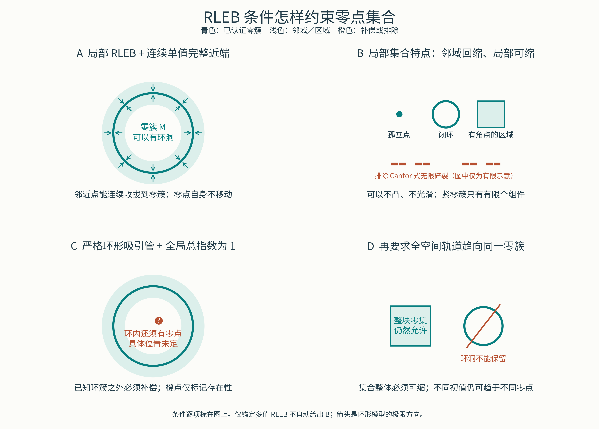

# 满足条件后的零点集合：正向几何图注

本图回答“已满足 RLEB 及相应局部／全局条件后，零点集合必然呈现哪些特点”。不把集合外形作为算子准入判据。青色表示被认证零簇，橙色标记额外零点的存在性或被相应条件排除的形状。



**A：邻域可连续收拢。** 固定同一完整连续单值物理近端，并通过局部 RLEB 的覆盖、真残差、兼容、留域及统一消失尾界。极限映射连续且固定零点，零簇因此为邻域回缩。图示使用严格法向平均环形模型，浅色表示半径 $R=0.26$ 的认证输入窗，全部箭头起点都在其中。为核严格预算，使用更宽的开管 $U=\{d(x,M)<0.6\}$；环半径 $0.9$，故仍低于 reach。以 $\lambda=1,L=0,\gamma=1,\psi(t)=t,\kappa=1/2,\bar t=0.13$ 核同窗；完整真残差的远端纤维桥沿用保整个更宽管的完成。最大预算 $0.26<0.6-0.26$，内外输入窗边界也合法。箭头指向极限，不表示一步到达。零点自身驻定，不沿箭头移动；环心不在局部窗内，不由 A 断言其轨道趋环。

**B：局部拓扑有规则，但外形可以多样。** 沿用 A 的完整连续单值及物理尾条件，零簇局部可缩；紧目标只有有限个组件。孤立点、闭环和有角点的区域是不同允许形状的示意，不表示它们必须共同组成某个指定算子的完整零集。Cantor 式无限碎裂被该分支排除；图中有限横段仅表示这一无限层级形状，不能当作证明。全对 RL 可以供应近端的连续单值门；仅锚定多值 RLEB 不自动供应它。

**C：全局条件限制环内补偿。** 在平面完整连续近端上，给定闭环目标及整个严格收缩输入管，合取全局总指数 1 的条件。管内边界位移方向同伦于向内管法向；环内区域的指数为 1，因此内部还存在零点。橙点不是定位结果，也不意味着只有一个额外零点。该结论是严格环形整管的区域推断，不能只由一条轨道或任意局部图块调用。依据见分量指数证明卡及其一手 Gauss degree 接口。

**D：全域吸引限制整体拓扑。** 沿用连续完整物理映射和局部统一吸引域，并另核全部全空间初值最终进入同一零簇的认证域。若只假设距离趋零，则这里还取目标紧，以保证有限进入。全空间极限映射为连续回缩，零集整体可缩，闭环不能作为完整全局吸引零集。凸方形是已完整认证的正面例子：整块集合都可为零集，各初值仍可有不同极限零点。图中的“整体可缩”是集合拓扑性质，不表示 PPA 把集合内零点移动到同一点。

可导出文件：[PDF](图件/RLEB零点集合直观特征.pdf)、[SVG](图件/RLEB零点集合直观特征.svg)。全称证明见[零集几何研究](RLEB零集几何分类研究.md)。图示不代替证明。

复算与渲染：

```bash
python3 research/code/rleb_zero_geometry_classification/verify.py
RLEB_CJK_FONT=/path/to/NotoSansCJKsc-Regular.otf RLEB_FIGURE_DIR=发表成果整理/本轮重构/图件 python3 research/code/rleb_zero_geometry_classification/draw_geometry.py
```

脚本在没有指定现有字体时，会从 Noto CJK 官方仓库下载中文字体到输出目录。字体来源：`https://raw.githubusercontent.com/notofonts/noto-cjk/main/Sans/OTF/SimplifiedChinese/NotoSansCJKsc-Regular.otf`。本次使用外部工作字体缓存，不将字体二进制加入仓库。

实际检查包括环形模型内边界、零距离、外边界的精确一步距离反算；箭头起点均在管内；先前方形完整纤维验证器的零输入、角点、边界和远端输入；全部文字边界无裁切，以及 PNG 人工可视检查。数学性质来自解析证明，渲染检查只负责图与结论一致。
