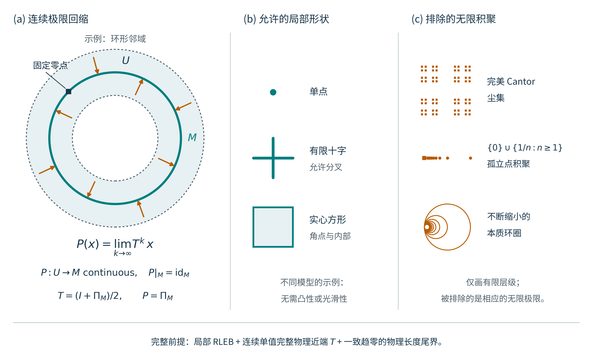

# 近端收敛条件怎样约束零点集合

## 1. 为什么从轨道转向零点集合

近端点算法求解包含问题

\[
0\in F(x),\qquad S=\operatorname{zer}F.
\]

一次收敛的近端运行给出一个极限零点。从不同初值反复运行，仍可能只发现同一块零点簇，而完整零集还包含其他部分。例如，对非凸目标取 $F=\partial f$ 时，零点是所采用次微分意义下的驻点；算法发现的局部极小点并不代表全部驻点。因此，轨道收敛以后，还可以问一个集合层面的问题：**使轨道稳定趋向零集的条件，对零集本身施加了什么限制？**

这个问题有两个尺度。在局部，收敛证书能否说明一块零簇怎样与附近的初值联系？在全局，已经认证的局部吸引结构，能否与完整算法的全局条件相容；若不能，是否必有其他零点补足缺失的结构？回答这些问题，既不要求先解出全部零点，也不把算法极限、一般驻点和局部极小点混为一谈。

本章的主线是：**先由近端几何和真实残差得到统一的距离衰减与位移预算，再由连续算法的极限得到零簇的邻域回缩，最后在独立的全局指数条件下推断其余零点。** 三步使用的条件逐渐增加，所得结论也逐渐加强。

## 2. 两个估计怎样产生近端收敛

固定 $F:\mathbb R^n\rightrightarrows\mathbb R^n$ 和 $\lambda>0$。完整近端关系为

\[
J_{\lambda F}(x)=\{y:(x-y)/\lambda\in F(y)\}.
\]

这里的“完整”表示保留该方程的全部输出。它满足 $x\in J_{\lambda F}(x)$ 当且仅当 $0\in F(x)$；单值时，完整零集就是完整近端映射的固定点集。先允许它多值；这一节的估计对每个输出成立。取非空紧目标 $M\subset S$，以及包含 $M$ 的开工作域 $W$。记 $d(x)=d(x,M)$。完整真实残差始终是

\[
r_F(y)=\inf\{\|w\|:w\in F(y)\}.
\]

固定 $R,\bar t>0$。在共同输入窗 $W_R=\{x\in W:d(x)\le R\}$ 上，要求每个输入有近端输出。对每个这样的 $x$ 和每个完整输出 $y$，要求存在最近零点锚 $p\in M$，使 $\|x-p\|=d(x)$ 且

\[
\|2y-x-p\|\le Ld(x)^\gamma,
\qquad L\ge0,\quad 0<\gamma\le1.
\]

这个反射估计控制一步移动的大小。事实上，令 $t=d(x)$，由

\[
2(y-x)=(2y-x-p)-(x-p)
\]

立即得到

\[
\|y-x\|\le B(t),\qquad B(t)=\frac{t+Lt^\gamma}{2}.
\]

第二个估计把残差转成到目标的距离。在实际输出上，若 $r_F(y)\le\bar t$，要求

\[
d(y,M)\le\psi(r_F(y)),
\]

其中 $\psi:[0,\bar t]\to[0,\infty)$ 有限、非减，$\psi(0)=0$，且在零点连续。近端包含提供的是一个残差上界：

\[
r_F(y)\le\frac{\|x-y\|}{\lambda}
\le\frac{B(t)}{\lambda}.
\]

它没有把被选中的图值认作最小残差。若同一组常数满足

\[
\frac{B(R)}{\lambda}\le\bar t,
\qquad
\psi\!\left(\frac{B(t)}{\lambda}\right)\le\kappa t
\quad(0<t\le R),\qquad 0<\kappa<1,
\]

则误差界确实可用于这些输出，并给出

\[
\boxed{\ d(y,M)\le\kappa d(x,M),\qquad
\|y-x\|\le B(d(x,M)).\ }
\]

这就是本章使用的 RLEB 收敛证书：反射几何供应步长上界，真实残差误差界供应距离转换，同窗兼容把二者合成为严格收缩。零距离输入也受同一估计控制：若 $x\in M$，最近锚就是 $x$，反射估计迫使每个输出均为 $y=x$。

距离缩小还不足以保证物理点收敛，因为点可能沿零簇附近移动。为控制这一移动，定义剩余长度预算

\[
\Theta(t)=\sum_{j=0}^\infty B(\kappa^jt)
=\frac12\left(\frac{t}{1-\kappa}
+\frac{Lt^\gamma}{1-\kappa^\gamma}\right).
\]

若初值满足

\[
d(x^0,M)\le R,\qquad
\Theta(d(x^0,M))<d(x^0,\mathbb R^n\setminus W),
\]

则每个有限前缀的总移动都小于初值到工作域边界的距离。因而输出留在合法输入域，覆盖可以反复调用。对每条完整近端轨道都有

\[
d(x^k,M)\le\kappa^kd(x^0,M),\qquad
\sum_{j=k}^\infty\|x^{j+1}-x^j\|
\le\Theta(\kappa^kd(x^0,M)).
\]

尾长趋零使轨道成为 Cauchy 列；目标闭且距离趋零使极限属于 $M$。严格长度预算又使极限留在 $W$。这些结论对全部完整输出成立，不依赖挑选一支。

## 3. 从统一收敛到邻域回缩

现在增加一个明确条件：**同一个完整近端关系在所用邻域内是连续单值映射 $T$。** 锚定 RLEB 本身不提供这个条件；同一完整图的全对反射控制和输入覆盖可以另行供应它。

令 $D_W(x)=d(x,\mathbb R^n\setminus W)$，并取

\[
O=\{x\in W:d(x,M)<R,\ \Theta(d(x,M))<D_W(x)\}.
\]

若 $W=\mathbb R^n$，到空补集的距离取 $+\infty$。$O$ 是包含 $M$ 的开邻域。它也是前向不变的，因为

\[
\Theta(t)=B(t)+\Theta(\kappa t)
\]

以及一步估计给

\[
D_W(Tx)\ge D_W(x)-\|Tx-x\|
>\Theta(\kappa d(x,M))
\ge\Theta(d(Tx,M)).
\]

严格正值首先证明 $Tx\in W$；距离收缩随后证明 $Tx\in O$。因此所有连续迭代 $T^k$ 都定义在同一个开集上。定义极限映射

\[
P(x)=\lim_{k\to\infty}T^kx.
\]

上一节的尾界在该开集上统一成立：

\[
\sup_{x\in O}\|T^kx-P(x)\|
\le\Theta(\kappa^kR)\longrightarrow0.
\]

所以 $P$ 是连续映射，并满足

\[
P:O\to M,\qquad P|_M=\operatorname{Id},\qquad PT=P.
\]

因此，**$P$ 是从开邻域 $O$ 到 $M$ 的连续回缩，$M$ 是欧氏邻域回缩**。直观上，算法把附近初值送到零簇上；零簇上的点保持不动，而且初值稍作变化，最终落点也连续变化。$P$ 一般不是最近点投影；算法的切向移动也参与决定落点。

回缩是关于一个连续极限映射的陈述。它没有自动给出把整个邻域随时间连续压缩到 $M$ 的形变回缩，也没有自动给出邻域与 $M$ 的同伦等价。这里真正起作用的是共同消失的物理尾长，不能用“每条轨道分别收敛”替代。

图中圆周是零簇，附近初值沿完整局部近端迭代趋向圆周，极限映射保持圆周各点。它说明邻域回缩的含义；圆形实例的完整关系、作用域和常数见[图注](RLEB邻域回缩示意图_图注.md)。该图不代表全空间都被圆周吸引。

## 4. 零点可以长什么样，哪些形状被排除

先看反射几何单独能限制什么。设完整连续近端映射在全空间定义，并记 $C=2T-\operatorname{Id}$。若它满足全尺度界

\[
\|C(x)-C(z)\|\le L_*\|x-z\|^{\gamma_*},
\qquad L_*>0,\quad0<\gamma_*<1,
\]

则对任意两个零点 $s,t$，完整固定点关系给 $C(s)=s$、$C(t)=t$，从而

\[
\|s-t\|\le L_*\|s-t\|^{\gamma_*},\qquad
\operatorname{diam}S\le R_*=L_*^{1/(1-\gamma_*)}.
\]

在同一 $\lambda,L_*,\gamma_*$ 下无法继续扩张而仍保持全图反射界的关系，称为固定参数图极大的 RL 关系。在有限维该类中，这个范围限制是精确的：允许的完整零集恰为直径不超过 $R_*$ 的非空紧集。任意这样的紧集都可实现，故反射几何本身不强迫凸性、光滑性或局部可缩性。进一步，给定非空紧集 $K$、直径 $D$，可以实现完整零集恰为 $K$ 的全域单值 Lipschitz 原算子，并使反射映射的最小全局 $\gamma_*$-Hölder 常数恰为 $D^{1-\gamma_*}$。直径端点能够达到；该实现结论不附带 RLEB 吸引性。

RLEB 加上上一节的连续性与统一尾界，则真正限制了局部形状：认证零簇是欧氏邻域回缩，简称 ENR，因而具有局部可缩性。这个性质的具体含义是：给定 $p\in M$ 及其任意相对邻域 $V$，可以把一个更小邻域在 $V$ 内连续收拢到 $p$。证明很直接：选小球 $B(p,\varepsilon)\subset O$，使 $P(B(p,\varepsilon))\subset V$；对 $z\in M\cap B(p,\varepsilon)$ 使用

\[
H(t,z)=P((1-t)z+tp),\qquad 0\le t\le1.
\]

线段留在小球，故这确实是较小邻域的包含映射在 $V$ 内到常值的同伦。它没有声称较小邻域在自身内部可缩。

| 局部形状 | 连续完整近端与统一 RLEB 尾界下的判断 | 直观原因 |
| --- | --- | --- |
| 孤立点、有限个分离的零簇 | 可以出现 | 各簇可以有各自的吸引邻域 |
| 圆周、球面等光滑零簇 | 局部可以出现 | 只需附近点收拢到簇上，不需把簇自身压成一点 |
| 有限十字、有限分叉、带角点的区域 | 不被回缩性质排除 | 回缩不要求流形、光滑性或凸性；十字已有完整机制例 |
| Cantor 型碎裂零簇 | 被排除 | 任意小邻域中仍缺乏所需局部连通与收拢结构 |
| 孤立零点无限聚积到簇内一点 | 被排除 | 聚积处不能满足局部可缩性的邻域条件 |
| 在一点堆积不可缩小环的 Hawaiian earring | 被排除 | 任意小邻域保留不能在指定邻域内收缩的小环 |

表中的“可以”说明结论不排除该形状；它不是从形状反推 RLEB 的判据。排除项也只适用于满足连续完整近端与共同尾界的认证零簇。一般多值锚定 RLEB 首先保证的是距离吸引和可和物理移动，不能直接承接这些拓扑结论。

因此，从不能出现的形状抽离出的共同属性是：**零簇具有与统一吸引过程相容的邻域回缩结构。** 它比凸性宽得多，也比逐轨道收敛强。若进一步假设全空间的每个初值最终进入同一个认证开集 $O$，且完整 $T$ 在全空间连续，则还得到更强结论：完整零集就是 $M$，而且 $M$ 可缩。

为看清最后一步，对每个初值选有限进入时刻 $m$；由连续性，其附近初值也在该时刻进入 $O$，故可局部定义 $P_{\mathrm{glob}}=P\circ T^m$。等式 $PT=P$ 使这些定义相容，给全空间连续回缩。固定点不可能停在 $O$ 外，所以 $S=M$。取 $p_0\in M$，

\[
P_{\mathrm{glob}}((1-t)z+tp_0)
\]

便把 $M$ 收缩到 $p_0$。这一全局结论不强迫只有一个零点：实心区域和有限十字都可以是可缩集合。圆周则可以局部吸引，却不能在这些条件下吸引全空间全部初值。

## 5. 为什么局部吸引还可能迫使其他零点存在

邻域回缩描述局部形状。要推断未知零点，还需把局部与全局的固定点指数连接起来。下面使用经典指数性质：局部化、可加性、同伦不变性，以及紧 ENR 上的 Lefschetz 归一化。欧拉示性数

\[
\chi(M)=\sum_i(-1)^i b_i(M)
\]

记录集合的拓扑，其中 $b_i$ 是有理系数的 Betti 数。对有界开隔离区域 $V$，要求 $T$ 在其闭包邻域连续、边界没有固定点；固定点指数 $i(T,V)=\deg(\operatorname{Id}-T,V,0)$ 记录该区域中的净贡献。若一个紧固定点簇与其余固定点隔离，$i(T,M)$ 表示在只包含该簇的邻域中计算的指数。指数与欧拉示性数不是同一个定义。

为使用最短的局部指数桥，另设 $M$ 是非空紧 $C^2$ 无边界嵌入流形，并选闭管 $N_\rho=\{x:d(x,M)\le\rho\}$ 落在共同认证窗内，且 $0<\rho<\operatorname{reach}(M)$。这里 reach 是由附近点最近投影唯一性定义的最大半径；上述选择保证整个闭管都有唯一投影。统一 RLEB 的一步估计给

\[
d(Tx,M)\le\kappa d(x,M)\quad(x\in N_\rho),
\qquad T|_M=\operatorname{Id}.
\]

故 $T$ 把管严格映入内部，且管内固定点恰为 $M$。记包含映射为 $i:M\hookrightarrow N_\rho$。光滑管的法向缩放给出到 $M$ 的形变回缩，因此 $i_*$ 是同调同构。又因 $T\circ i=i$，有 $T_*i_*=i_*$，从而 $T_*=\operatorname{Id}$。结合管边界没有固定点，经典 Lefschetz 归一化及指数换空间性质给

\[
\boxed{\ i(T,M)=\chi(M).\ }
\]

这里的同调桥来自另行认证的光滑管，不能从上一节的一般邻域回缩中省略推导。

全局指数必须独立计算。例如，若全空间反射映射满足上一节的次线性 Hölder 界，则

\[
\|C(x)\|\le\|C(0)\|+L_*\|x\|^{\gamma_*}<\|x\|
\]

在充分大球面及其外侧成立。球面上 $x-sC(x)$ 对全部 $0\le s\le1$ 都不为零，而固定点方程是 $x=C(x)$。因而全部固定点被包在大球内，$\operatorname{Id}-T=(\operatorname{Id}-C)/2$ 的总指数为 $1$。也可以由原模型独立认证大球或立方体的严格自映及域外排根；那是另一条全局入口，须保留其独立条件。

由指数可加性，记其余零点为 $K=S\setminus M$，即得

\[
\boxed{\ i(T,K)=1-\chi(M).\ }
\]

当右侧非零时，$K$ 必非空。这是一条无需先求出 $K$ 的存在推断。如果已另证其余零点有限、孤立且每点指数为 $\pm1$，才进一步有

\[
\#K\ge|1-\chi(M)|,\qquad
\#K\equiv1-\chi(M)\pmod2.
\]

连续近端映射在这些点附近 $C^1$ 且 $\det(I-DT)\ne0$ 是一个足够的非退化条件；一般退化点可能独自承担较大的整数指数。

| 已认证的光滑吸引零簇 | 局部指数 | 总指数为 $1$ 时其余零点的净指数 |
| --- | ---: | ---: |
| 一个点 | $1$ | $0$ |
| 一个圆周 | $0$ | $1$ |
| 二维球面 | $2$ | $-1$ |
| $m$ 个分离的吸引点 | $m$ | $1-m$ |

圆周一行说明：局部算法可以稳定趋向一个圆，但在此全局条件下，完整零集不能只有该圆。球面一行还说明：其余零点必须提供负的净指数。指数没有指定精确位置或稳定类型；若同时具有全尺度预算，额外零点须在投影管外，并满足与任一已知零点距离不超过 $R_*$，从而得到一个可认证的候选位置范围。

全输入覆盖与全局吸引应在这里分清。覆盖只保证每步有输出，完全允许不同初值去往不同零簇。局部 RLEB 也不要求全空间趋向 $M$；若加上上一节的全局进入条件，就已经得到 $S=M$ 与可缩性，此时不能再用同一组条件宣称另有未知零点。

## 6. 比总欧拉数更细：保持局部算法需要多少新零点

还有一个与算法有关的结构问题。假设已经给定整个严格吸引管上的完整更新 $T_0$，我们要求全局算法在这个管上逐点保持原样。全局延拓至少需要增加多少零点？仅知道 $\chi(M)$ 不总能回答，因为管外可能分成互不连通的区域。

取 $n\ge2$，$M$ 为上一节的紧光滑无边界流形，$\rho<\operatorname{reach}(M)$，整个 $N_\rho$ 上的 $T_0$ 固定 $M$ 并满足共同严格距离收缩。另设 $C_0=2T_0-\operatorname{Id}$ 在整管上为有限 $\gamma_*$-Hölder 映射。取包含管的大球，把

\[
\overline B_R\setminus\operatorname{int}N_\rho
\]

分成连通区域 $W_1,\ldots,W_s$。在内边界使用归一化位移 $(x-T_0x)/\|x-T_0x\|$，在外球使用 $x/R$，并按每个区域的诱导边界定向计算次数 $\delta_j$。这些次数满足

\[
\sum_j\delta_j=1-\chi(M).
\]

对任意给定的全尺度 Hölder 完成，可以进一步扩大外球，使其位移在外球面上同伦于径向映射，并排除球外固定点。扩大外球只给无界管外分量附加球壳，不改变各 $\delta_j$。因此，每个非零 $\delta_j$ 都要求相应的整个管外连通分量内有补偿零点。在达到构造中，则可以把补偿点预先放在所选截断区域的内部。

允许全局延拓使用同一指数 $\gamma_*$、某个有限新常数，并逐点保留整个原输入管，则这个下界能够达到：

\[
\boxed{\min\#\text{新增零点}=\#\{j:\delta_j\ne0\}.\ }
\]

若要求新增点全部非退化，则精确最小数量改为

\[
\boxed{\min\#\text{新增非退化零点}=\sum_j|\delta_j|.\ }
\]

在两种达到构造中，可以预先指定各区域内补偿点的位置。一般孤立点可以承担任意整数指数，而非退化点只能承担 $\pm1$，这正是两个公式不同的原因。达到证明还需经典无零延拓以及保持整管原值的 Hölder 提升；次数下界本身不保证完整近端的达到性。

一个二维比较使区别可见。两条互不嵌套的吸引圆周，其两个圆盘内部各有缺额 $+1$，共同外部有缺额 $-1$。两条嵌套圆周，从内向外的三个管外区域分别是最内圆盘、中间环域和最外区域，缺额依次为 $+1,0,0$；中间环域的两条边界贡献为 $-1$ 与 $+1$，恰好抵消。两种嵌入都有总欧拉数 $0$，但最少新增孤立零点数分别为三和一。**零簇如何嵌入环境空间，能够给出比总欧拉数更细的完成限制。**

所有达到构造都以同一个完整原关系解释：

\[
\widehat T=\frac{\operatorname{Id}+\widehat C}{2},\qquad
\operatorname{gph}\widehat F
=\left\{\left(\widehat T(x),\frac{x-\widehat T(x)}{\lambda}\right):
x\in\mathbb R^n\right\}.
\]

图点的近端输入恰为 $x$，故完整 $J_{\lambda\widehat F}=\widehat T$，完整零集恰为 $\operatorname{Fix}\widehat T$。这个身份保证完成结论没有遗漏另一个近端分支。

保留整管更新不自动保留完整真实残差误差界：远端输入还可能产生落入局部输出区的图值，使残差下确界变小。若要求完成后的算子继续满足同一局部真残差证书，必须另核远端完整纤维。

对法向平均模型 $T_0=(\operatorname{Id}+\Pi_M)/2$，这一步可以直接核验。若 $y\in N_{\rho/2}$，记 $s=d(y,M)$。投影管中的法向线段保持同一个最近投影，因此管内唯一反输入为

\[
x_{\rm loc}=\Pi_My+2(y-\Pi_My),\qquad
T_0x_{\rm loc}=y,\qquad\|x_{\rm loc}-y\|=s.
\]

任何管外反输入 $x\notin N_\rho$ 都满足

\[
\|x-y\|\ge d(x,M)-d(y,M)>\rho-s\ge s.
\]

所以无论还有多少远端反输入，完成后完整原关系的真实残差均为

\[
r_{\widehat F}(y)=d(y,M)/\lambda\qquad(y\in N_{\rho/2}).
\]

取工作域 $W=\operatorname{int}N_\rho$、输入半径 $R=\rho/3$、残差窗 $\bar t=\rho/(6\lambda)$、$\psi(t)=\lambda t$、$L=0$、$\gamma=1$、$\kappa=1/2$，第2节全部局部证书由同一组常数成立：$B(t)=t/2$、$\Theta(t)=t$，输出距目标为 $t/2$，并且 $\Theta(t)=t<\rho-t\le D_W(x)$ 对 $t\le\rho/3$ 成立。该误差界只用于局部输出管，不涵盖远端补偿零点。反射完成的全局指数 $\gamma_*$ 与这里的局部锚定指数 $\gamma$ 是两个参数。

## 7. GPPA 怎样进入这条主线

对固定核 $v:\mathbb R^n\to\mathbb R^n$，GPPA 的完整更新是

\[
x^{k+1}\in(v+\lambda F)^{-1}(v(x^k)),
\qquad v(x^k)-v(x^{k+1})\in\lambda F(x^{k+1}).
\]

完整关系在 $x$ 处包含 $x$ 当且仅当 $0\in F(x)$。这个固定点身份不要求核单射，但核坐标收敛仍不意味着物理点收敛：同一核值可以有不同物理原像。

因此，本章几何结论有两条合法入口。其一，直接认证完整物理更新连续单值、物理距离收缩和共同物理尾长，再使用邻域回缩证明。其二，给出已核验的连续共轭或相容物理提升，把核结论送回同一个物理算法；一般影子零集不能替代物理零集。Euler 结论还要另核物理隔离管和全局指数入口。

固定正定度量也是一个具体算法选择。换度量后须重新检查完整覆盖、所有输出、固定点、真实残差和兼容常数；不能仅凭矩阵正定便宣布原例的全部证书保持成立。

## 8. 这条研究线推进什么

收敛部分推进的是非单调近端分析：用反射模与真实残差误差界组织同一个算法的存在、留域、距离衰减与有限长度，并通过精确恢复命题说明与已有理论的关系。零点几何部分沿此继续，研究这套可核验动态条件在集合层面留下什么结构。

前面的结果区分了三个问题：在给定反射预算下实现完整零集，认证已有零簇附近的吸引，以及保持整个局部更新的全局完成。**定量实现**给出可达到的直径边界；**连续吸引证书**给出邻域回缩与局部形状限制；**保整管完成**则把局部拓扑转化为逐区域的补偿零点数量。后一个结论允许改变 Hölder 常数。若进一步要求保持原常数，非单点零簇的完成问题仍需新的定量分析。

共同尾界产生连续回缩，属于经典固定点理论的机制，可对照 [Pérez García–Fetter Nathansky（2010）Lemma 2.1](https://journals.umcs.pl/a/article/download/3985/2887) 与 [Wiśnicki（2014）Lemma 2.1](https://www.tmna.ncu.pl/static/published/2014/v43n1-06.pdf)；指数接口使用 [Benjamin–Gottlieb（2006）§2.1](https://www.math.purdue.edu/~gottlieb/Bibliography/62.pdf)。[Luke–Tam（2025）Theorem 1](https://pubsonline.informs.org/doi/10.1287/moor.2025.0863) 则研究广义非单调关系的局部纤维结构。这里进一步追问的是固定反射预算的精确边界、完整真实残差怎样接入吸引几何，以及保留给定整管近端动力的全局完成代价。各项条件与结果都可以在同一个原算子和算法上逐条核对。

应用的目的则是部分求解：先认证一块零簇及易验证的全局边界条件，再读出未逐个求解的零点信息，最后用独立方程或可靠求解证书核对。是否比原模型已有方法更短、更强或更易认证，需要由具体模型的对照证明决定。本章给出这一用途的数学入口，不以存在推断本身宣称普遍计算加速。
